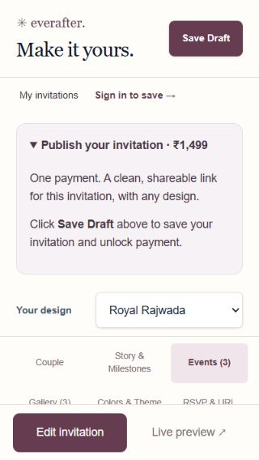
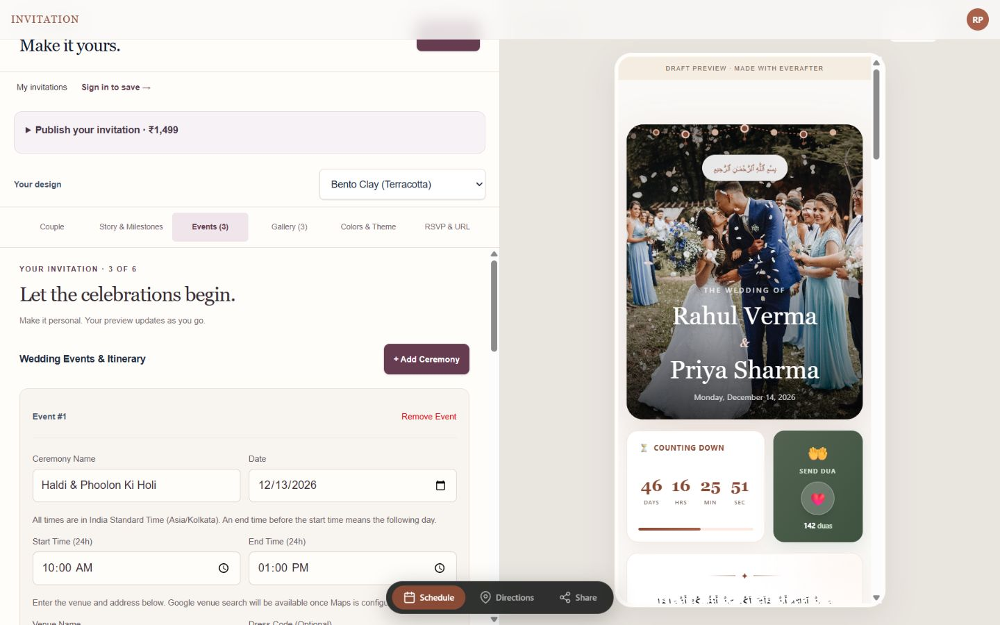
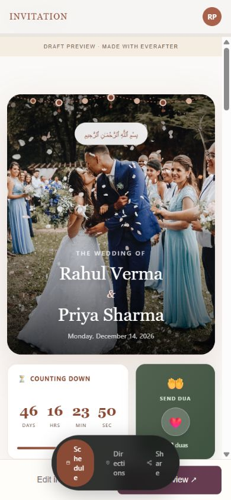

# Everafter — functional, UI/UX and responsive audit

Date: 28 October 2026. Audit only: no application fixes, dependency updates, remote database writes, emails, payments or deployment were performed. This report and its screenshots are the deliverables.

## Overall assessment

The latest tested code builds and its 17 automated tests pass. It is not yet ready for a customer launch. The most urgent problems are small-screen editor usability, Bento preview overlays, losing edits through direct sign-in, fixed personal information in Nikah, and incomplete RSVP behavior. Passing unit/database tests does not cover these customer journeys.

Source changed externally while the audit was running. The first typecheck reported an unknown `userEmail` prop; the first build then reported a missing `useEffect` import. These changes were subsequently completed outside this audit. A second typecheck and production build passed. The last observed Git commit was `710aa9d` (`your update message`). Do not treat those first compilation failures as still-open defects in this snapshot.

## What was tested

| Check | Result | Scope / qualification |
| --- | --- | --- |
| `npm run typecheck` | PASS on second run | Initial run occurred during concurrent editor changes |
| `npm test` | 17/17 PASS | Validation, template server rendering, maps, calendars, HMAC and actual migrations in PGlite |
| Production build using `NEXT_BUILD_DIR=.next-verify` | PASS on second run | First run failed during concurrent edits |
| `npm audit --omit=dev --json` | 2 affected packages | 1 high, 1 moderate; Next's nested PostCSS dependency; see issue 18 |
| Production browser audit | Completed for accessible flows | Separate local server on port 3001; no application code changes |
| Browser console during template switching | No warnings/errors captured | Limited to the audit tab, not a guarantee for every flow |
| Homepage/login HTTP | 200 | Anonymous requests |
| Unknown public invitation | 404 | Does not prove access control for an actual saved draft |
| Invalid editor UUID | 404 | `/studio/not-a-uuid` |
| Private editor without session | 307 to login | Tested with a synthetic UUID |
| Cross-origin checkout POST | 403 | Expected rejection |
| Same-origin malformed checkout JSON | 400 | Expected validation |
| Same-origin checkout and payment-status without session | 401 | Expected authorization |
| Webhook with absent provider configuration | 503 | Safe configuration error; real signed callback delivery remains untested |
| Invalid gallery URL | Browser prevents invalid URL submission | Native URL input validation; not an uploaded-image validation test |
| Direct sign-in navigation after editing | FAIL: changes lost | Reproduced with an audit-only name in an unsaved draft |
| Save Draft → sign-in page → return to editor | PASS: draft restored | Local pending-draft recovery works through this particular path |

Initial API checks used port 3000 as the Origin against the port 3001 test server and were correctly rejected. Repeated same-origin checks used port 3001 and produced the 400/401 results above.

The development server on port 3000 timed out during one 10-second HTTP request and initial browser navigation. The isolated production server responded correctly. This is a development-environment observation, not evidence that the production application is generally slow.

### Responsive matrix

| Viewport | Observations |
| --- | --- |
| 320 × 568 | Homepage navigation becomes cramped. Editor has about 97px of form height with Publish closed. Expanded Publish places form content behind/below the bottom switch. |
| 390 × 844 | Original editor layout is usable but controls above the form consume nearly half the height. All five template previews fit horizontally; Bento floating controls overlap the editor switch. |
| 768 × 1024 | Single-panel tablet editor; approximately 606px form height. No root horizontal overflow in the measured state. |
| 1024 × 768 | Split layout activates; editor approximately 511px wide, form 404px high, preview canvas 364px wide. No root horizontal overflow measured. |
| 1440 × 900 | Standard split editor works. Bento header spans the full 1440px viewport instead of its preview, obscuring editor controls. |

All five designs were selected and rendered at phone width: Royal Rajwada, Minimal Sage, Boho Floral, Nikah Emerald and Bento Clay. At 390px, their measured preview client and scroll widths were both 375px. This checks horizontal containment, not every combination of content or a real paid public page.

## Priority issues

P1 = resolve before customer launch. P2 = important usability/completeness work. P3 = polish or later refinement. “Browser confirmed” means directly reproduced. “Source confirmed” means visible in implementation but not exercised through a real authenticated/live-provider journey.

### 1. P1 — Small phones cannot use the editor with Publish expanded

**Browser confirmed.** At 320 × 568, the form begins around y=402 with Publish closed and has only 97px height. Opening Publish moves its top to approximately y=528 while the bottom Edit/Preview bar starts around y=499. The form and lower tabs become covered/clipped. The saved-payment form is longer still, but that state was not tested with a real account.

Cause: `src/app/globals.css:210` fixes the shell to `100dvh` with `overflow:hidden`; the publication panel and multiple navigation rows sit outside the scrollable `.studio-form` (`:225`).

**Recommendation:** make the whole editing page scroll, keep only a compact header and bottom switch persistent, and open publication as a dedicated step or sheet with its own scroll region. Do not place a full payment form above a constrained form viewport.

**Acceptance:** every field, section and payment action remains reachable at 320 × 568, landscape, and with a phone keyboard open.

### 2. P1 — Bento template overlays escape the preview

**Browser confirmed.** Select Bento Clay in the desktop studio. Its fixed header covers the studio branding/Save area across the entire browser, and its floating navigation sits partly over the form. At 1440px, the template header measured x=0, width=1440. At 390px its bottom navigation overlaps Edit/Preview, becomes about 94px tall, and breaks “Schedule”, “Directions” and “Share” into unreadable fragments.

Locations: `src/templates/BentoClay.tsx:328` and `:795` use viewport-fixed elements inside an embedded preview.

**Recommendation:** contain sticky/floating elements within the template preview, or use an isolated iframe preview. Give the navigation a controlled width and nonbreaking labels. Account for the editor's bottom controls and safe-area inset.

**Acceptance:** no template element intercepts Save, design selection or Edit/Preview at any tested viewport; navigation labels remain whole words.

### 3. P1 — Direct sign-in loses an unsaved invitation

**Browser confirmed.** Change Bride's Name to `Audit Unsaved Name`, click **Sign in to save →**, then **Explore the editor first →**. The name returns to `Priya Sharma`. By contrast, clicking **Save Draft** first stores and restores the changed name correctly.

Location: `StudioEditorClient.tsx:179` stores a pending draft only inside `handleSave`; the sign-in link around `:286` navigates without that preservation step. There is no general unsaved-navigation warning or continuous recovery mechanism.

**Recommendation:** give all routes out of an unsaved editor the same preservation behavior, expose a persistent Unsaved/Saved state, and add validated, versioned draft recovery. Explain whether data is stored on this device or in the account. Offer undo/recovery rather than surprising navigation.

### 4. P1 — Nikah publishes personal details that are not the couple's data

**Browser and source confirmed.** Nikah displays `Kunhimoideen & Sainaba`, `Yousef & Fathima`, and `Kerala, India` for the Hyderabad sample couple. These names and location cannot be edited through the existing `WeddingData` form.

Locations: `NikahEmerald.tsx:282`, `:301`, `:439`.

**Recommendation:** remove invented personal information from the template. Render only fields supported by the approved shared schema; introduce a deliberate schema extension later if family details are required. Religious/design copy can be intentional, but personal names and locations must be accurate.

### 5. P1 — RSVP settings promise functionality that is not implemented consistently

**Source confirmed, with settings visible in the browser.** Royal, Sage and Boho show active-looking online RSVP buttons when no WhatsApp number is supplied, but these buttons have no submission handler. There is no RSVP submission API in the current route tree. The dietary preference toggle has no guest form to affect. Nikah does not render a guest RSVP section; Bento's WhatsApp sharing is not an RSVP workflow.

Locations: `RoyalRajwada.tsx:282`, `MinimalSage.tsx:221`, `BohoFloral.tsx:224`; shared `rsvps` table exists without the guest submission flow.

**Recommendation:** either ship a complete, shared RSVP form and owner guest list, or clearly offer WhatsApp-only RSVPs and hide unsupported settings/actions. Do not label an inert control “Active upon publish”.

**Acceptance:** a guest submits attendance and receives confirmation; the owner sees it; disabling RSVPs and configured dietary fields behave consistently across all designs.

### 6. P1 — Newer templates can show the wrong calendar day overseas

**Source plus runtime reproduction.** Nikah/Bento format `new Date('YYYY-MM-DD')` in the viewer's local timezone, without the UTC date-only protection used by the original templates. In a Node runtime set to `America/Los_Angeles`, `2026-12-14` displayed as **December 13, 2026**. Bento's event date badges also use local `getDate()`.

Locations: `NikahEmerald.tsx:14`; `BentoClay.tsx:17`, `:533`, `:536`. Their countdowns target the date at UTC midnight rather than an actual ceremony start time.

**Recommendation:** use one date-only formatter and derive countdown targets from an explicit, appropriate event time. Keep the existing shared IST calendar generator. Test India, US and European timezones. This is not a failure of the already-tested shared `.ics` utility.

### 7. P2 — Bento sharing and directions can point to the wrong destination

**Browser and source confirmed.** Preview WhatsApp URLs contain `/studio/new` (and sometimes the template query), because the share text uses `window.location.href`. They also preselect the couple's RSVP phone number, which is not the same as choosing recipients to share an invitation. The floating Directions link uses raw `events[0].googleMapsUrl`; sample data therefore opens generic Google Maps while event-card directions correctly point to the venue.

Locations: `BentoClay.tsx:313–321`, `:812`, `:828`.

**Recommendation:** make preview sharing unavailable or clearly marked as a simulation; share only the canonical published invitation URL. Separate “Share invitation” from “RSVP to couple”. Reuse the shared directions helper for every directions action.

### 8. P2 — Theme and content controls behave differently between designs

**Browser/source confirmed.** Bento remains fixed to its own font/color choices after selecting Modern Sans. Nikah also does not consume the theme colors/font. “Playfair / Editorial” is offered, but the original templates reduce non-sans choices to Georgia and no Playfair font is loaded. Nikah destructures story/gallery but does not render the editable story/gallery sections. The editor does not explain these design limitations.

**Recommendation:** define supported features for each template and either implement those shared features or hide/disable irrelevant controls with an explanation. Do not offer a font name that is not actually loaded.

### 9. P2 — Bento's direct template URL silently selects Royal

**Browser confirmed.** `/studio/new?template=bento-clay` selects Royal Rajwada. The registry/save schema/database support Bento, but the page's query-parameter allowlist omits it (`studio/[weddingId]/page.tsx:89`).

**Recommendation:** use one typed template catalogue for URL selection, editor options and validation. Add a route-level regression test for every registered ID.

### 10. P2 — Homepage hides two available designs and the actual price

**Browser confirmed.** Homepage cards advertise three designs while the studio has five. Nikah and Bento are undiscoverable there. Pricing says “Pay once when you publish”; the ₹1,499 amount appears only inside the editor.

**Recommendation:** populate the catalogue from the registry, show representative real previews, explain design-specific features, and show the publication price before people spend time editing. Use a preview action distinct from selecting a design.

### 11. P2 — Important controls and action names are not accessible enough

**Browser/source confirmed.** Four color inputs have no programmatically associated label. The slug field is announced using its current value rather than “Unique URL Slug”. Gallery removal buttons are all announced as `✕`, without identifying the image. Many section labels are 11px; several template labels are 8–10px.

Locations: `StudioEditorClient.tsx:667`, `:692`, `:720`, `:777`; `globals.css:223`.

**Recommendation:** associate every input label, name removal actions such as “Remove photo 2”, provide clear focus/error relationships, and use larger text for essential information. Keep comfortable touch targets. A 44–48px product target is useful; WCAG's AA target-size criterion is 24px with exceptions, so not every smaller-than-44px control is automatically a compliance failure. No complete WCAG certification or exhaustive contrast audit was performed.

### 12. P2 — Save/publish progress is unclear

**Browser/source observation.** Save Draft looks available to an anonymous visitor but leads to sign-in after a one-second error message. Editing does not produce a persistent unsaved indicator; the dirty-state explanation is inside Publish. The six sections show position, not completion/readiness. Payment collects customer details before the server can return the first missing invitation field.

**Recommendation:** give the flow explicit stages: Design → Details → Preview → Publish. Keep current save status visible. Add a concise publish-readiness summary that links directly to incomplete fields, while keeping price and saved-state explanations clear.

### 13. P2 — Removing content has no undo

**Source confirmed.** Event, milestone and gallery removals immediately filter local state. There is no undo or recovery prompt. On touch devices an accidental removal can cost significant writing time.

**Recommendation:** show an Undo action after removal; confirm only for substantial destructive changes. Preserve unsaved form state across ordinary navigation.

### 14. P2 — Media entry is not a finished customer workflow

**Browser/source confirmed.** Customers must paste image URLs; there is no upload, crop, ordering or managed storage workflow. There is no audio input in the current editor even though `WeddingData` supports background music. Most templates do not play it. Bento has audio playback code, but suppresses play errors and lacks cleanup/update handling for a changed audio source.

**Recommendation:** add an upload-first flow with progress, limits, crop/preview, reordering and useful failures. Keep URLs as an advanced option. Add an explicit, user-controlled music feature only to templates that support it, with playback failure feedback and cleanup.

### 15. P2 — Blessing counts look like real engagement but are sample state

**Browser/source confirmed.** Nikah and Bento initialize at **142**. Clicking only increments component state; no shared persistent count is used. Reloading resets it. A customer could interpret this as genuine guest engagement.

**Recommendation:** remove the received-count claim, label the interaction as a decorative demo, or implement real per-invitation storage with appropriate abuse controls.

### 16. P2 — Animation and image delivery need resilience/performance work

**Source review.** RevealOnScroll renders sections at `opacity:0` until JavaScript/IntersectionObserver runs. Critical content can remain hidden if hydration fails or scripting is unavailable. Images use ordinary eager `` tags without a general responsive-size/lazy-load policy; third-party image failures have no designed fallback. Default sample images loaded in this audit, so a universal broken-image issue is not claimed.

**Recommendation:** make essential content visible by default, progressively enhance animation, verify reduced-motion behavior, and load/compress images according to their actual display size. Run real network-throttled mobile measurements before claiming performance targets. The initial login JS budget was about 202KB; this alone is not a measured Core Web Vitals failure.

### 17. P2 — Automated coverage misses key customer flows

**Confirmed test scope.** Current tests validate important helpers and database rules, but do not detect mobile overlays, broken template deep-links, losing edits during sign-in, false family data, a working guest RSVP, or a successful purchase in a deployed environment.

**Recommendation:** later add browser regressions for these specific failures and a controlled sandbox acceptance suite. Keep unit tests; supplement them rather than treating their pass count as a launch gate by itself.

### 18. P2 — Production dependency audit requires review before launch

**Tool confirmed.** `npm audit --omit=dev` reports the nested PostCSS package as high severity and Next as an affected moderate package. Audit suggests a major Next update, so an automatic force-fix is inappropriate. The project does not presently expose arbitrary user CSS processing; actual exploitability was not demonstrated.

**Recommendation:** review the installed dependency chain and all listed advisories, choose a supported patched upgrade path, and rerun regression/build checks. No packages were changed by this audit. [Primary PostCSS advisory](https://github.com/advisories/GHSA-6g55-p6wh-862q).

### 19. P2 — Blank-key demo behavior has regressed

**Source confirmed, not tested by deleting configuration.** The studio page now calls `createClient()` unconditionally, including `/studio/new`; its environment helper throws when Supabase settings are absent. Documentation still says the sample editor works without keys.

**Recommendation:** either preserve an explicit, safe anonymous demo path independent of Supabase configuration, or show a friendly configuration page and correct the documentation. Do not restore the old service-role authentication bypass.

### 20. P3 — Information architecture and launch details need cleanup

**Browser/source review.** “RSVP & URL” combines guest settings and publishing identity. Slug help shows a slash instead of a clear full link; there is no prominent copy-link action. The homepage lacks readily visible contact/support and policy links, and global metadata sets `noindex` for the marketing homepage as well as invitations. Nikah/Bento use cultural copy with the generic Hindu event sample, making previews feel inconsistent.

**Recommendation:** put URL/share actions in Publish, provide copy-link feedback after verification, use template-appropriate demo content without inventing customer facts, and make support/pricing/policy navigation easy to find. Decide indexing separately for marketing, private studio, and public invitations. This is product/deployment guidance, not a legal compliance assessment.

## Suggested work order — no implementation performed

1. Fix the two layout blockers and contain template navigation.
2. Unify draft preservation and make save/publish status clear.
3. Remove fixed personal information; fix timezone/date inconsistencies.
4. Finish or clearly limit RSVP, sharing, theme and media capabilities.
5. Improve catalogue discovery, field labels, text sizing and undo behavior.
6. Review dependency updates, then run configured two-account and sandbox-payment acceptance checks.

For the editor redesign, prioritize more usable space over decorative changes: a compact header, a single scrollable editing area, a clear active section, and a separate publish step. Keep the existing mobile Edit/Preview switch, but ensure template controls cannot cover it.

## Deferred tests / limits

- Actual Google OAuth/email sign-in, email delivery and session refresh; no sign-in emails were sent and no external account was selected.
- Real authenticated save/reopen, two-account ownership isolation over Supabase/PostgREST, and paid public rendering. PGlite permission tests passed, but do not replace these checks.
- Cashfree sandbox order creation, modal/payment-app behavior, webhook retries and reconciliation. Configuration is absent; no charge or provider order was created.
- Live Google Places autocomplete/map embed; the UI reports missing configuration. Manual directions URL construction is tested.
- Apple/Outlook calendar import on real devices; shared calendar generation has automated tests.
- Real iOS Safari/Android Chrome, onscreen keyboard behavior, screen readers, OS text scaling, and throttled networks. Browser viewport emulation is not a substitute for all of these.
- Real paid public-page screenshots: preview-specific containment can differ from standalone rendering.
- Comprehensive penetration testing, a complete accessibility audit, load testing and formal Core Web Vitals measurement.

The GitHub push from the earlier request is outside this audit; its earlier remote-access failure was not resolved here. No commit or push was performed by this audit.

## Accessibility references

Use [W3C contrast guidance](https://www.w3.org/WAI/WCAG22/Understanding/contrast-minimum.html) when checking colors against their actual backgrounds, and [W3C target-size guidance](https://www.w3.org/WAI/WCAG22/Understanding/target-size-minimum.html) when judging control sizes and spacing. Small text and cramped controls reported here are usability findings; they are not all asserted to be formal WCAG failures.

Immediate next step: review the six P1 items and choose the first repair batch. The audit has deliberately left application code unchanged.
